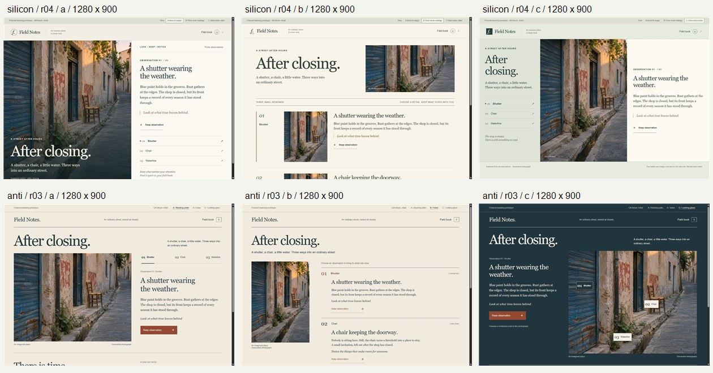
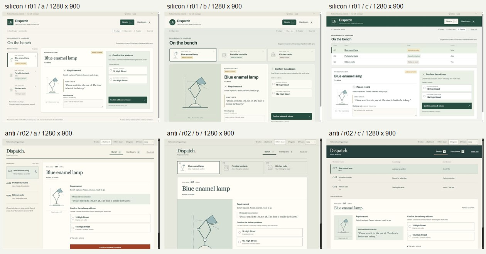
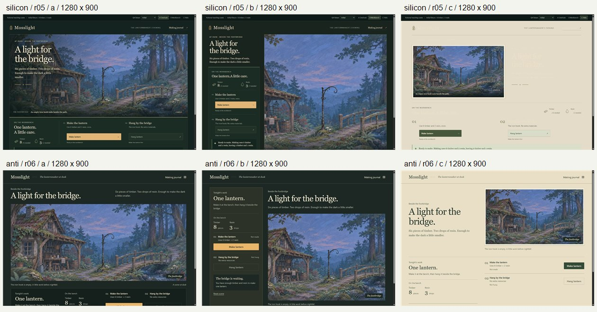

# Silicon Design × Anti Slop: first matched trial

**Silicon Design did not establish a win.** Both conditions delivered working prototypes, but Silicon lost on a theme's actual text contrast, recovery from the handover book, and the phone workbench's priority. Its three directions did not demonstrate greater diversity. These are findings from one operator, who knew the conditions, with one generation per condition and brief; they are not audience preference or attachment measurements.

[Try the comparison](https://drevendev.github.io/Silicon-Design/benchmarks/2026-11-03/) · [Protocol](PROTOCOL.md) · [Performed checks and limits](VERIFICATION.md) · [Inputs](input-manifest.json) · [Outputs and run records](run-results.json)

## What was matched

Six fresh-context agents implemented Read / Operate / Experience, using either Silicon's five skills at `053649a` or Anti Slop's core/UI/mobile/human/copywriting skills at `941b153`. Every pair received identical positive DESIGN.md, prompt, words, state model, fixture and artwork. All three working directions were retained, including failures. The gallery shows the original artifacts, not their revisions.

Each agent had the same 600-second coordinator allowance and tools, with no model override. Exact served model version, sampling parameters, seed, token use and billing are unavailable. Skill input sizes were 22,920 versus 140,591 bytes, not measured tokens or cost. This is a comparison of those supplied packages, not every configuration of either project. Generation-time browser/network/image generation were forbidden in the common prompt; complete execution traces are not exposed for an independent tool audit. The operator reviewed in a browser only after freezing outputs.

The initial CLI engine rejected six requests before generation; those infrastructure failures produced no designs. The working engine was selected before any successful generation. Run r03 ended with a capacity error **after** complete runnable files, RUN.md and source checks had been written; its artifacts remain in the comparison and passed the exercised browser tasks. No unsuccessful visual candidate was replaced. Timing records are coordinator observation bounds, not precise model latency. See the [run records](run-results.json).

## Results by brief

| Brief | Exercised work | Silicon loss / comparative judgment |
| --- | --- | --- |
| Field Notes | Both: select, keep/remove two observations, empty/populated book, invalid note focus, safe Cyrillic/markup-like text, saved-edit preservation, direction retention and reload reset | No operational advantage found in this scope. Anti C's spatial pins on the photograph add a genuinely different inspection model. Silicon offers hero, prose rows and index arrangements, but has no demonstrated diversity lead. |
| Dispatch | Both: reject missing/18 address, release only lamp to 18a, collect turntable, blocked radio, correct receipts/counts and undo | After undoing the only handover from its record, Silicon leaves an empty Handovers view and BODY focus; Anti returns to the restored job and 18a choice. Anti also leaves BODY focus. Silicon loses task context in addition to the shared focus weakness. |
| Mosslight | Both: make 8/3 → 2/1, interrupt with journal, retain state across directions, hang without extra cost, prevent duplicates, reset to 8/3, block insufficient 4/1 fixture | Silicon C inherits light ink on paper: necessary quantities/body/headings almost disappear. Its phone Workbench B puts the making action below the scene; Anti B puts the work first. |

### Read — no diversity lead

Silicon A leads with the street image and overlaid title, B develops three prose/detail readings, and C uses an index beside image and selected text. Anti A is a reading plate, B a text-first index with a cropped image, and C places selectable pins on the photographed subjects. The latter changes how an observation is found, beyond changing typography or paper color. It remains a conventional button interaction with a useful spatial relationship.

Both sets largely share the brief's editorial paper/ink, serif-heading vocabulary. Silicon A has a strong image-led opening; that is an operator judgment about composition, not proof that people prefer or remember it. The [phone sheets](captures/r04-phones.jpg) and [Anti phone sheets](captures/r03-phones.jpg) preserve the alternatives. Neither set proves a distinctive product people will love.

### Operate — recovery matters more than a convincing desk

Reproduce in original direction A: choose 18a → release lamp → Handovers → open record 017 → Undo handover. Both restore 3 open / 0 handovers and the chosen correction. Silicon stays on the empty handover collection, requiring another navigation to resume. Anti returns to the lamp on the bench. In both, the active element becomes BODY after the rerender. Evidence: [Silicon after undo](captures/r01-undo-context.jpg), [Anti after undo](captures/r02-undo-context.jpg), and the focus observations in [browser records](browser-observations.json).

The compositions converge: sidebar ledger, object tray/large drawing, and register with selected record. Silicon A's desktop record is more compact; Anti's longer record places release at document Y≈1280 on the phone versus Silicon's ≈1420. Neither number establishes usability by itself. Both added an optional workshop/visit note outside the requested capabilities: Silicon exposed it directly, Anti tucked it behind a disclosure. This is shared scope drift, not evidence that extra fields express care.

### Experience — a passing palette table missed near-invisible text

In original Silicon C, computed foreground `#ebdfc7` on opaque paper `#e4dcc8` gives **1.0353:1**. This affects body copy, a 49px title, step headings and owned quantities, not just the exempt brand logo. It fails both the applicable ordinary-text 4.5:1 and qualifying-large-text 3:1 thresholds. The agent's declared swatch comparisons passed because they never measured the inherited pair actually used. [WCAG contrast explanation](https://www.w3.org/WAI/WCAG22/Understanding/contrast-minimum.html).

At 390×844, Silicon's Make button starts at document Y≈997 / 924 / 1036 in A/B/C. Anti's starts at ≈873 / 650 / 932. The critical comparison is **Workbench B**: Silicon collapses into another scene-first stack while Anti retains a work-first option. [Silicon phone sheet](captures/r05-phones.jpg) · [Anti phone sheet](captures/r06-phones.jpg). Original Silicon action type is 13px desktop / 14px phone, versus Anti's 16px. This is a contextual hierarchy/readability observation; font size alone is not a WCAG failure, and not every scene needs its action above the fold.

Both sets converge on a dark scene, a workbench, and a paper folio. Silicon's world painting and integrated journal sustain the supplied atmosphere, but both use the same fixed art. A coherent asset palette is not a diversity victory.

One operator error is explicitly excluded: the first Anti game macro tried to operate the page behind its open native journal dialog. Closing it through its actual **Close journal** control let direction switching, hanging and reset work. Earlier `hung`/`reset` observations from that invalid path are retained as diagnostics, not product failures; use `hung-real-close-path` and `reset-real-close-path`.

## Changes to principles and all five skills

| Evidence | Bounded change | Where |
| --- | --- | --- |
| Desktop alternatives converge after reflow; Workbench loses work priority | Compare first attention, useful action and next transition at both sizes; preserve the direction's intended priority | P03; direction and game skills; DESIGN.md template |
| Light folio inherits dark-theme ink | Inspect resolved foreground/background roles across materially different themes, quantities and overlays; swatch checks alone are insufficient | P11; system/game/review skills; color foundation |
| Undo requests focus but destroys the originating surface | Exercise last-item undo from its real secondary surface; verify connected, visible focus and a useful task destination | P14; build/review skills; interaction foundation |
| Both add unsolicited note capabilities | Inventory real capabilities and fields; express care through the existing work | P06; direction/build skills; review checklist |
| A faulty modal macro suggested a false failure | Distinguish a test adapter mistake from the user's visible path; correct the path and retain the diagnostic | Review skill; verification record |

These edits respond to observed cases. They do not create a style blacklist, a universal above-fold rule or an extra approval ritual. They also do not prove that the revised skills will generate better outputs: that needs another matched generation.

## Separate operator-assisted repairs

Original files under `runs/` are byte-for-byte frozen. The following copies received additional operator feedback and editing after the trial; they are **not** equal-budget baseline wins.

| Repair | Recheck | Status |
| --- | --- | --- |
| [Dispatch revision](revisions/r01/index.html) restores the bench, selected order and actual corrected-address focus after undo | Repeated the same last-record path at 1280×900 and 390×844. Counts 3/0; corrected input focused; Tab continues to release. [Wide](captures/r01-undo-wide-after.jpg), [phone](captures/r01-undo-after.jpg) | Resolved for the exercised lamp path. Other focus paths and invented notes remain. |
| [Mosslight revision](revisions/r05/index.html?direction=c) explicitly maps paper ink and keeps painted overlays local | Actual title/quantity ink `#2b352d` on `#e4dcc8`: **9.3161:1**; initial/error/complete C inspected. [After](captures/r05-c-after.jpg) | Resolved for measured roles, not whole-product accessibility certification. |
| [Mosslight phone workbench revision](revisions/r05/index.html?direction=b) places work before scenery and uses 16px action type | Make begins at Y≈594; make → hang leaves 2/1 and lit painting; reset restores 8/3 and real Make focus. [After](captures/r05-b-phone-after.jpg) | Resolved for the exercised B phone flow. No new visual direction was generated. |

The first attempted ink repair changed only a custom property, leaving already inherited color unchanged. Browser inspection caught that too; the final repair explicitly sets the color on the paper ancestor. The failed intermediate observation remains in the record.

## What remains unproven

There was no blinded human preference study, audience recall/attachment test, repeated seed study, cost comparison, full keyboard/assistive-technology/zoom audit, native game runtime or physical-device test. The limited Tab check is not full keyboard coverage. The exact model/runtime gaps limit independent replication. Skill package size differs intentionally, and one sample cannot isolate a causal effect of a particular instruction.

The next credible superiority claim needs matched reruns with the revised skill revision, retained failures and independent human task/preference assessment. The [real-product validation in #2](https://github.com/drevendev/Silicon-Design/issues/2) remains separate. For now the useful result is a reproducible loss analysis and narrower, testable guidance.
