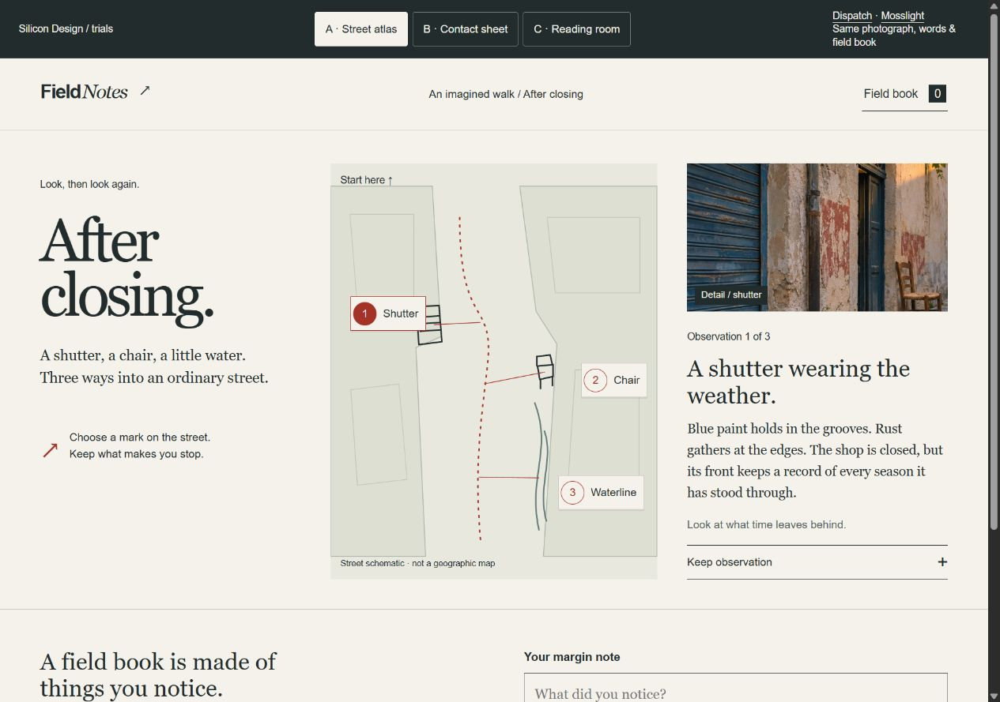
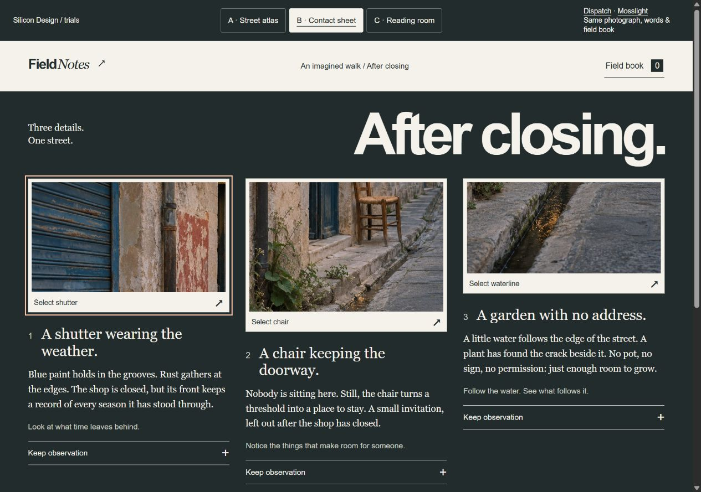
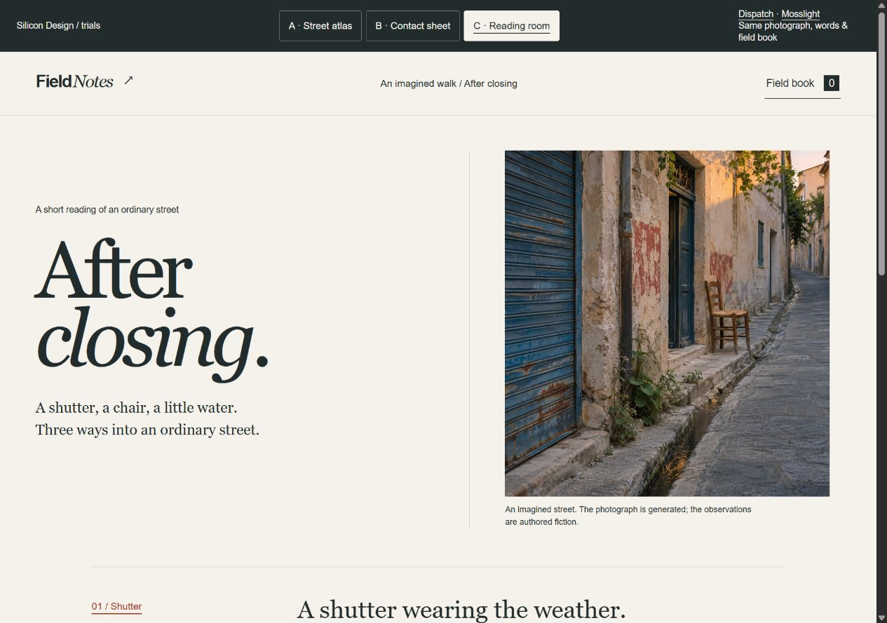
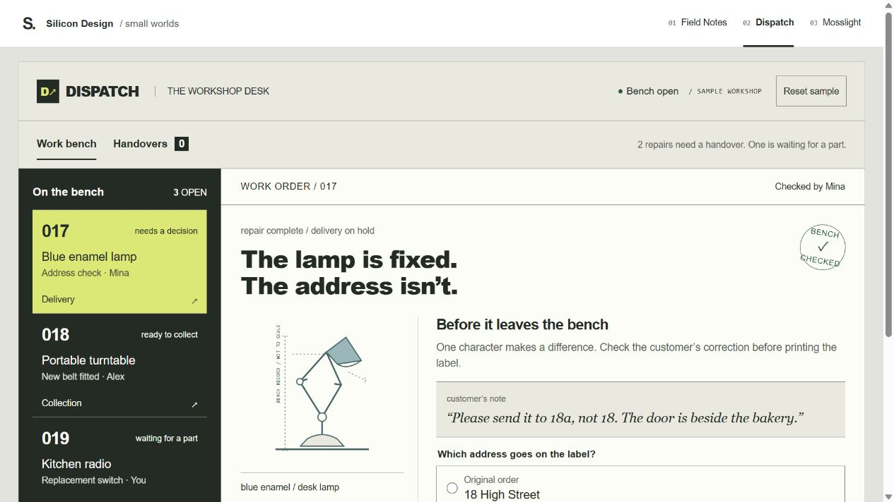
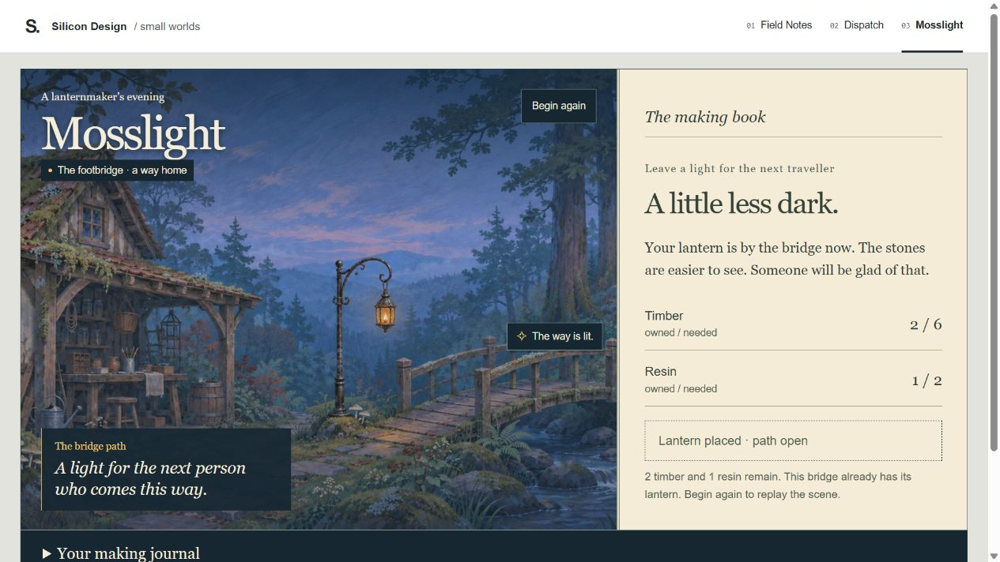

# Three small worlds, three ways into one street

**[Live gallery](https://drevendev.github.io/Silicon-Design/)** · **[Field Notes direction comparison](https://drevendev.github.io/Silicon-Design/examples/field-notes-directions.html)**

[Issue #8](https://github.com/drevendev/Silicon-Design/issues/8) showed why category styling was insufficient. The [application notes](../research/issue-8-application.md) connect research to revised principles, all five skills and these prototypes.

## One brief, three working alternatives

Same photograph, three exact observation texts, select/keep/remove, margin note and field book. Supporting invitation copy and framing adapt to each reading model. Same local state contract and shared model; differences are inspectable structures.

| Direction | Read it as | Try |
| --- | --- | --- |
| A · Street atlas | A place to explore, one observation at a time | [Atlas](field-notes-directions.html?direction=atlas) |
| B · Contact sheet | Three details to compare and collect | [Contact sheet](field-notes-directions.html?direction=contact) |
| C · Reading room | A continuous material with marginal keeps | [Reading room](field-notes-directions.html?direction=reading) |

**A · Street atlas is the selected gallery direction.** All alternatives remain available. The choice is recorded separately from unrun audience testing. [Decisions and tradeoffs](field-notes.DESIGN.md).

## Operate and experience

- [Dispatch](specimen.html?example=dispatch): a stable dark bench and readable work order. Resolve 18 versus 18a, release, collect the turntable, inspect real handover records and undo. The radio remains blocked for its stated reason. [Brief](dispatch.DESIGN.md).
- [Mosslight](specimen.html?example=mosslight): a painted scene beside a making book. Make a lantern, open/close its journal, hang it from the hook. The completed object is painted into the world. [Brief](mosslight.DESIGN.md).

All names, places, addresses and quantities are **fictional teaching material**. Images were generated for these examples; [prompts and provenance](assets/PROVENANCE.md). Object line drawings are original source SVG.

State lasts within each page visit. Field Notes retains it across its directions/book; Dispatch/Mosslight across their shared gallery page. Navigating to a different page or reloading starts a new visit. Explicit reset controls restore workshop/game fixtures. No backend, actual shipping, collection, account or game-save service is implied.

## Local development and publishing

The original [capacity fixture](capacity.html) adds a separate teaching task:
nine fixed offers fit a declared 1080×800 base viewport, while its
[96-item catalog](capacity.html?case=catalog) uses search, sorting and a scrolling
list. It has EN/RU text, exact per-unit/total prices, local purchases, blocked
states and keyboard-accessible detail. Narrow/enlarged-text views may scroll.
All content is fictional; state resets on reload. These are different content
tasks, not a new same-brief generation or preference experiment. See
[reference/capacity reasoning](../docs/references-and-capacity.md) and the dated
[verification](VERIFICATION.md).

Serve the repository root:

```sh
python -m http.server 8765 --bind 127.0.0.1
```

Open [local directions](http://127.0.0.1:8765/examples/field-notes-directions.html) or [local workshop](http://127.0.0.1:8765/examples/specimen.html?example=dispatch). Stop with Ctrl+C. Images/scripts are local; no external font, library or account is required.

GitHub Pages publishes master/root. Root index.html preserves query/fragment into specimen.html; its Field Notes route opens the direction comparison. Existing Dispatch/Mosslight deep links remain usable. No second source copy or generated build is maintained.

## Preview

Real browser captures of the implementation:











[Use-size/state sheet](STATE-SHEET.md) · [Review](REVIEW.md) · [Checks and limits](VERIFICATION.md) · [Anti Slop benchmark target](../research/benchmark.md). A comparative victory and reader attachment remain untested.

## Working corrections — 2026.11.15.1

[Matched fictional craft cases](craft/README.md) preserve deliberate failures beside corrections for composition, exact totals, glyphs, long content, input/recovery, chart reading and an owner-scoped link preference. [Seven complete synthetic websites](blind-test-demo/README.md) demonstrate independent navigation and explicit whole-site workload; they are runner QA, not evaluated designs. See [performed checks and limits](VERIFICATION.md).

## Decision and difficult-state examples — 17 November 2026

The original [Nightjar exchange, simulated document desk and offline controls](decisions/README.md) add draft/stale/refusal/recovery, physical-copy Inspect/return, stationary targets, asynchronous ownership/outcomes and matched material comparisons. [Performed checks and limits](decisions/VERIFICATION.md) are separate from the historical specimens.
