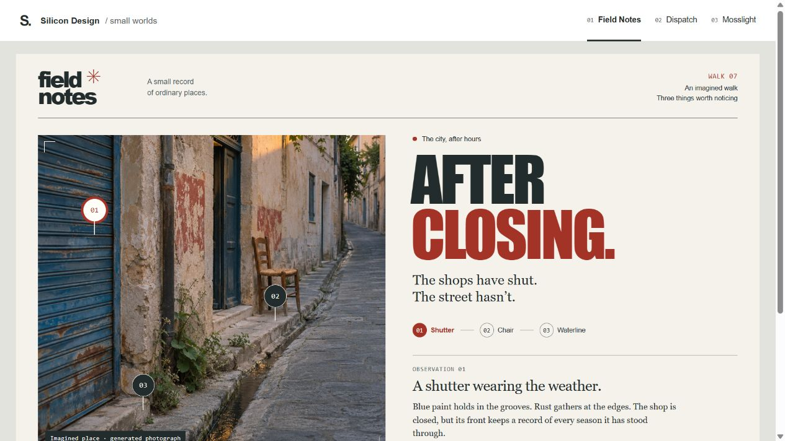
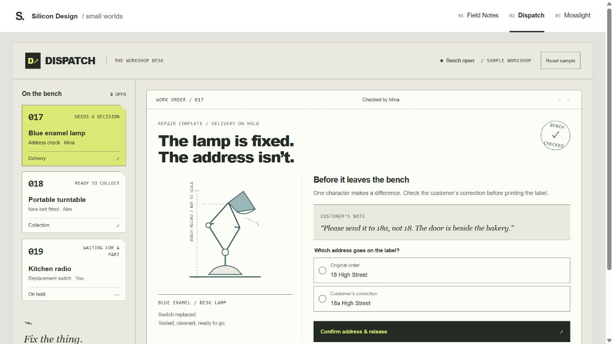
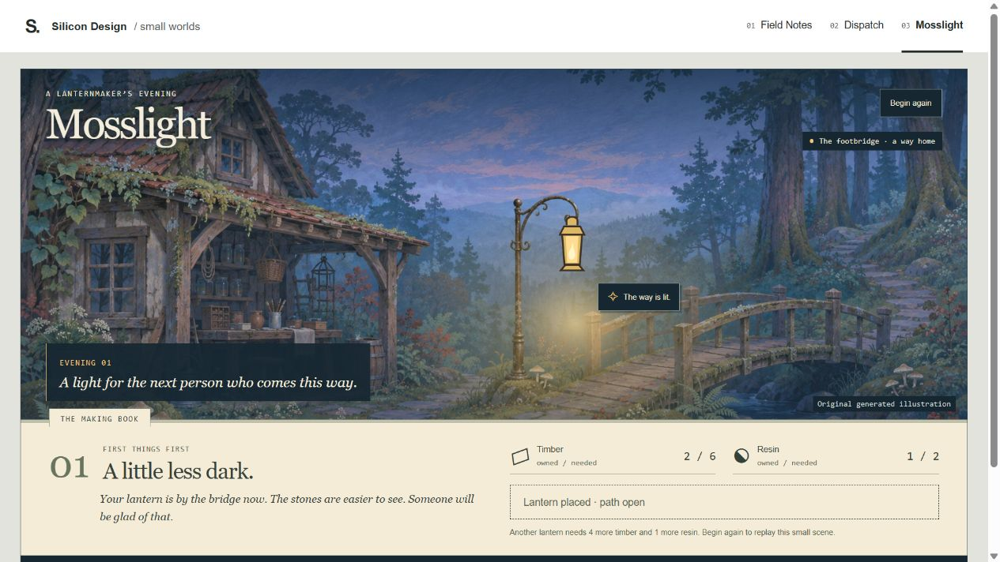

# Three small worlds

The first gallery changed palette and typography more than it changed the experience. This revision applies the handbook's direction, system, interface, game and review skills to the examples themselves: each has a specific subject, a recognizable action and a completed state.

Open [specimen.html](specimen.html) or serve the repository root:

```sh
python -m http.server 8765 --bind 127.0.0.1
```

Visit [the local gallery](http://127.0.0.1:8765/examples/specimen.html), then use the three links at the top. Stop the server with Ctrl+C. Images and scripts are local; no external fonts, libraries, account or service are required. Direct example URLs also work with `?example=field-notes`, `?example=dispatch` and `?example=mosslight`.

| Example | Character carried into use | Try it | Decisions |
| --- | --- | --- | --- |
| [Field Notes](specimen.html?example=field-notes) | A photographic walk becomes a personal field book | Select a numbered detail, keep an observation, write in the margin | [Brief](field-notes.DESIGN.md) |
| [Dispatch](specimen.html?example=dispatch) | A repair-workshop desk gives objects a way back into use | Compare 18 with 18a, release the lamp, undo; inspect the waiting radio | [Brief](dispatch.DESIGN.md) |
| [Mosslight](specimen.html?example=mosslight) | A lanternmaker leaves a little light for someone else | Make the lantern, hang it by the bridge, watch the path change | [Brief](mosslight.DESIGN.md) |

All names, addresses, quantities and places are **fictional teaching material**. The photograph and forest painting were generated for this revision; see [prompts and provenance](assets/PROVENANCE.md). Dispatch's object drawings and the placed lantern are original SVG work in the source.

Changes live in this page visit and survive switching examples. They reset on reload. Dispatch and Mosslight also offer explicit reset controls. There is no backend, shipping, actual collection, game save or claim of real field research.

## Preview

These are browser captures of the implemented page, not generated interface mockups. The Mosslight capture shows the completed action.







[Review of this revision](REVIEW.md) · [Performed checks and limits](VERIFICATION.md) · [Original critique](../research/specimen-critique.md)
