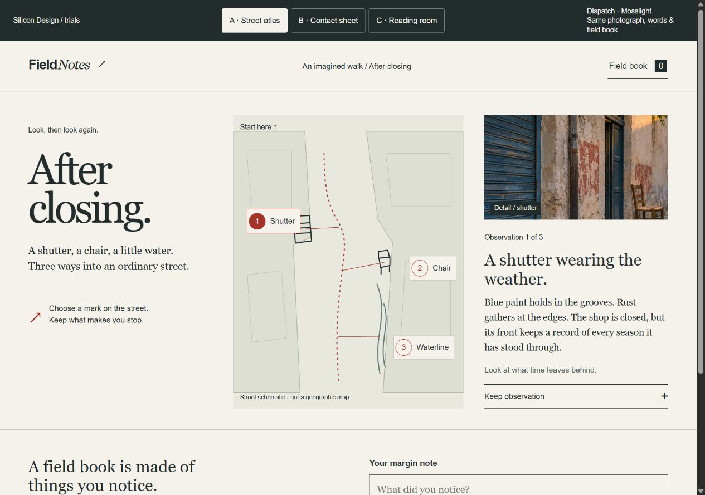
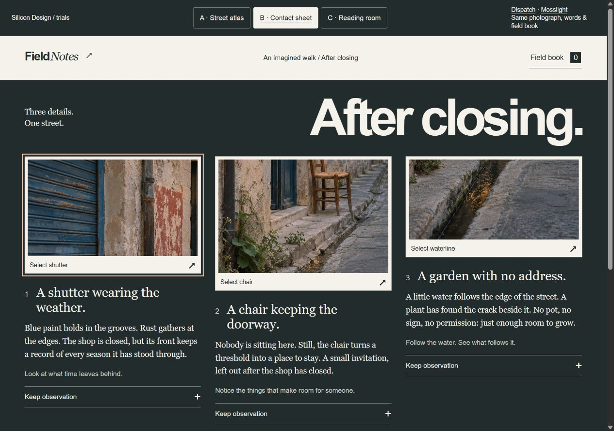
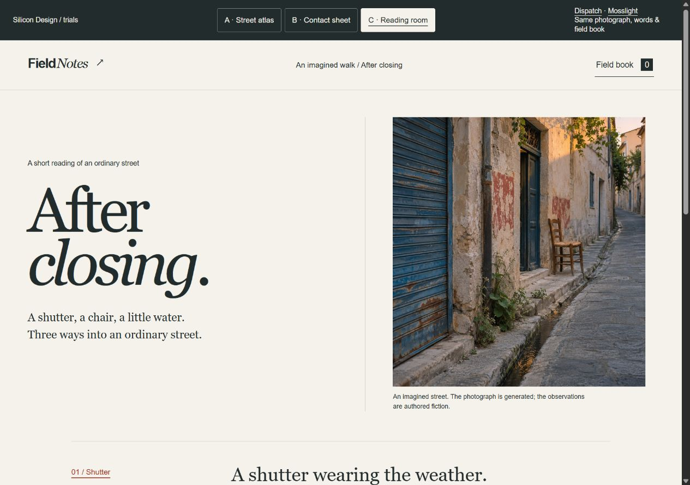
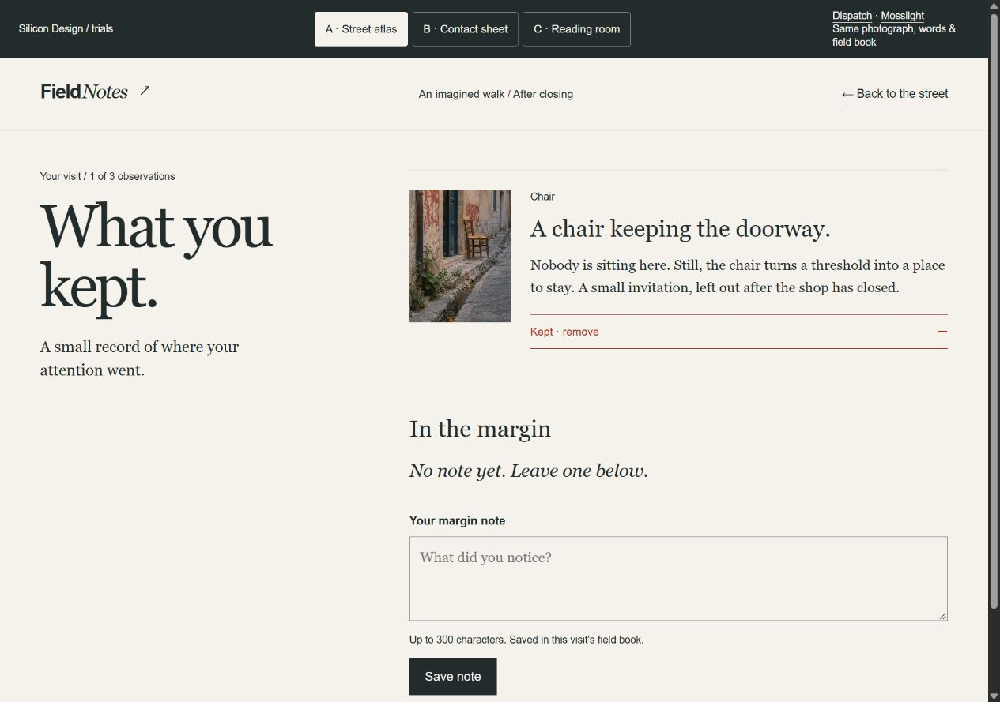
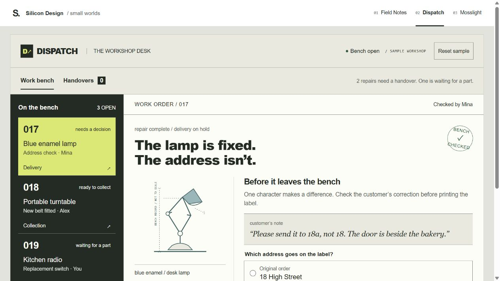
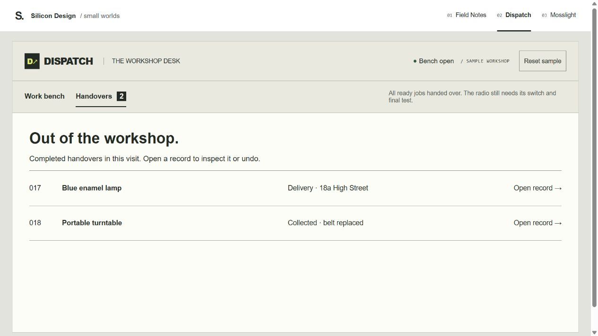
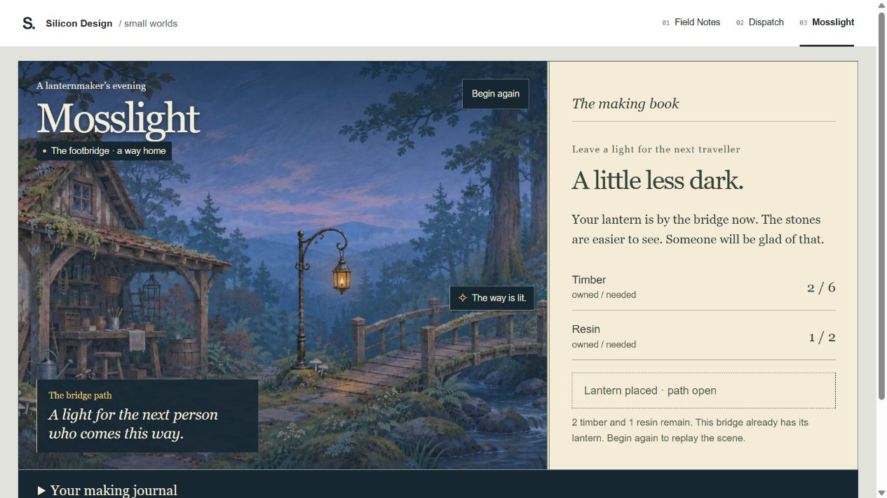

# Use-size grammar and state sheet

These are working components and browser states, not a separate design-system mockup. Inspect the linked pages at use size. Captures record a state; interactions remain in the implementation.

| Source / components | Stable grammar | States and second surface |
| --- | --- | --- |
| [Field Notes](field-notes-directions.html); `.map-stop`, `.keep`, `.note-form`, `.book-entry` | Paper/ink/red; Georgia reading, Arial actions; named detail crops; selection/kept labels and pressed states | Fresh/selected, keep/remove, invalid/saved/editable note, empty/populated book. One model across three directions. |
| [Dispatch](specimen.html?example=dispatch); `.job-ticket`, `.address-option`, `.handover-row` | Dark stable bench, lime selected job, white work order, coherent line drawings, readable operating values | Missing/wrong/correct address, collection, blocked radio, receipt/undo; actual empty/populated handovers. |
| [Mosslight](specimen.html?example=mosslight); `.game-scene`, `.craft-bench`, `.making-journal` | Painted world and painted completed object, cream book, exact costs/plain actions | Unmade/crafted/lit/reset, journal open/closed. World/journal derive from the same phase; opening help costs nothing. |

## Captures

Three initial direction captures at 1280×900. Dispatch/Mosslight at 1280×720. Different briefs are not a within-brief diversity measurement.

[Checks and limits](VERIFICATION.md) · [Correction log](REVIEW.md).
