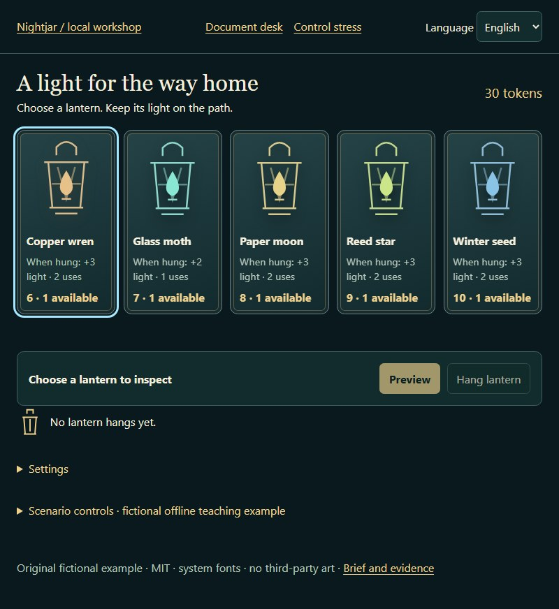

# Performed verification — 17 November 2026

Scope: original Nightjar exchange, document desk and controls; three complete material artifacts. Exact reviewed source identities and runtime are in [browser.json](evidence/browser.json); complete artifact hashes and costs are in [material-costs.json](material-costs.json). These receipts identify bytes rather than pretending a pre-commit working tree was a released revision.

Environment: Windows, Node 24.19.0, Playwright 1.62.1 / Chromium 151.0.7922.34, DPR 1, default 100% browser scale. The browser opened actual file URLs offline because loopback access was denied in the sandbox. No HTTP/service/model call or physical device was involved. The harness also supports HTTP for CI; that transport is not substituted for this run's file-URL receipt.

| Evidence | Observed result |
| --- | --- |
| Deterministic authority | Nine Node tests: cancel retains draft; stale refusal is atomic; one accepted charge; required hanging/guide survives restoration; legacy physical facts; corrupt-state refusal; workspace ownership; stop/late/duplicate replies; seven distinct outcomes; notice IDs and stale readiness |
| Browser input | Ten grouped scenarios, not nine independent trials: native edit/Escape/return, actual unforced edge activation after hover, real Preview/Confirm/Hang with coaching in flow/fixed layouts at 800 EN and 320 RU; no forced clicks |
| Transaction/recovery | Retained exact note across reload; changed stock charges nothing; one hanging consumes one physical use; rendering/reload does not replay feedback; separate preserved unreadable original survives a fresh session; denied storage keeps the current draft; blocked diagnostic simulation and actual exact-byte browser download distinguished |
| Temporal readers | Same legacy physical ID/revision/current uses through face, full reader and accepted-history Inspect; changing locale preserves choice and mounted return owner |
| Asynchronous application | Selected B while worker belongs to A; real simulated stages survive reload; manual work leaves scheduling paused; stop waits for release; distinct no-input/no-match/incompatible/draft/process-error/save-error; exact attempt/draft notices and focus; dismissed notice stays dismissed; stale readiness fails, current check succeeds |
| Materials | Plain/Engraved/Luminous matched 800 and 320 captures, same rules/content/compression, native Tab focus before capture, one accepted purchase per treatment. All five original vector offers render; Plain is the original no-halo fallback. No missing external asset can be silently substituted because none is consumed |
| Control stress | Native select arrows/Enter, checkbox Space, text entry, full record, dialog Escape/return, preference Enter; 44 px target with 18 px visible glyph; long EN/RU, exact/unknown values and original IDs. Input fields may scroll their own editable full value |
| Reflow and appearance | Actual 1280/640/320 viewports for all three pages; 800×600 exchange base fit; separately measured CSS root font 32 px at 390×844. Running forced-colors and reduced-motion emulation; reduced feedback has animation `none` and the same charge/hanging outcome; explicit Motion off also preserves the purchase |

[Ten resolved role pairs](evidence/resolved-pairs.json) were measured from the normal Engraved runtime, including SVG stroke inheritance and declared lightest gradient endpoint. They are scoped computed-pair checks, distinct from pixel inspection and the repository checker's 20 historical palette pairs. Disabled opacity, every painted gradient pixel and forced-colors system mappings are not certified.

Actual pixel inspection covered the retained matched material frames, RU 320 exchange, desk outcome/return and 640 layout, control error and forced-colors/text-enlarged frames. No named font or hue is treated as a rule. Author judgment selects Engraved for quiet workshop material; the halo remains a comparison, not a rejected human outcome. The small preference glyph is deliberately compact; recognizability for this teaching symbol is untested.

## Corrections and diagnostic boundaries

- A real close/reopen race let an old asynchronous dialog-close event cancel the next preview. Closure now updates the session synchronously; native Escape follows the same path.
- Long native select intrinsic width pushed the narrow control grid; bounded grid children and controls now reflow. An enlarged-text handoff sentence used an unbreakable slash sequence; plain-word separation removes its overflow.
- Desk notices and always-open history duplicated results. The latest outcome per workspace stays primary; the full exact history is a deliberate disclosure.
- An early stationary-target assertion compared viewport positions across browser auto-scroll. Corrected to document coordinates after bringing the control into view; actual unforced edge clicks are still required. Later RU cases use RU expectations. These were adapter corrections, not evidence of a moving product target.
- Initial browser launch used an unavailable redirected cache, then loopback was denied. Reused the installed browser cache and tested file URLs. Failed attempts are retained locally; they are not counted as passes.

## Untested

Actual browser zoom; physical touch/device/controller; native-platform rendering; screen-reader/AT use; listening (no audio is included); human reading comfort, comprehension, preference, attachment; autonomous reference discovery; new skill activation/generation/cost comparison. CSS text enlargement, resize, forced-colors/media emulation and screenshots do not establish those outcomes or accessibility compliance. #7 remains open for actual browser-zoom evidence; product outcome issues keep their own acceptance.

